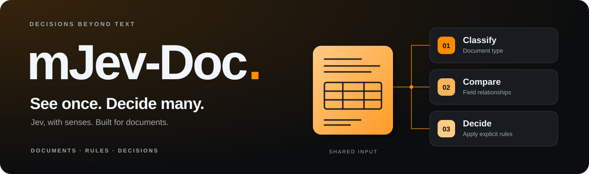
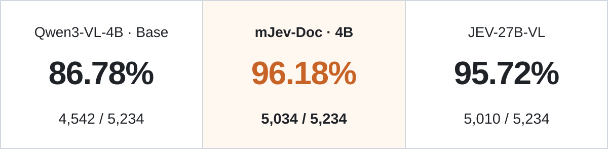

<p align="center">
  
</p>

<h1 align="center">SoMark｜mJev</h1>
<p align="center"><b>Multimodal state in. Typed decisions out.</b></p>

<p align="center"><a href="README.zh-CN.md">简体中文</a> &nbsp;&nbsp; <b>English</b></p>
<p align="center">
  <a href="https://huggingface.co/SoMarkAI/mjev-doc"></a>
  <a href="#start"></a>
  <a href="https://huggingface.co/datasets/Immortal-Zhang/DocJev-Bench"></a>
</p>

---

## 👀 Decision intelligence beyond text

**One visual input, multiple decisions.** Give mJev an image, document or video, then define your questions and candidates. It returns a choice, relative candidate probabilities and raw logits for each question.

**mJev-Doc focuses on documents:** classify pages, compare fields, check completeness, and route documents under rules you provide.

- **⚡ Keep the context**: reuse prefix KV across questions and batch them together.
- **🧩 Bring your choices**: set a different candidate list for each question.
- **🔎 Inspect the decision**: the selected answer, every candidate probability, and raw logits.

---

> If this project helps you, please click the ⭐ Star in the top right corner — it's the greatest encouragement for the developers!

<a id="models"></a>
<a id="mjev-doc"></a>

## 🧩 01 / For documents, start with mJev-Doc

<table>
<tr>
<td width="50%" valign="top">
  <h3>📄 mJev-Doc</h3>
  <p><b>Take document understanding into business decisions.</b></p>
  <p>Classification, field relationships, completeness, and review or routing under <strong>explicitly supplied rules</strong>.</p>
  <a href="https://huggingface.co/SoMarkAI/mjev-doc"><b>Get the model ↗</b></a>
</td>
<td width="50%" valign="top">
  <h3>🖼️ mJev</h3>
  <p><b>Turn images and video into choices.</b></p>
  <p>Scenes, objects, actions, order. Ask multiple questions about shared visual context, each with its own candidates.</p>
  <a href="https://huggingface.co/SoMarkAI/mJev-Qwen3-VL-4B-RLCD"><b>Get the model ↗</b></a>
</td>
</tr>
</table>

Both models use **Qwen3-VL-4B-Instruct**, with Hugging Face and vLLM inference. Audio and video with audio use the separate [Qwen3-Omni backend](docs/hf.md).

## 🎯 02 / Document decisions, measured together

**[DocJev-Bench](https://huggingface.co/datasets/Immortal-Zhang/DocJev-Bench)** · 608 images · 2,617 bilingual question pairs · **5,234 language records**

<p align="center">
  
</p>

One collection, covering **document understanding and decisions · cross-industry classification**. All 5,234 records are included.

<sub>Model-outcome-selected collection</sub>

[See evaluation results →](docs/docjev/results.md)

<details>
<summary><b>⚡ Other evaluations and cache performance</b></summary>

- **mJev general vision**: 195 questions, 77.95% → 80.00%. [Evaluation](docs/training.md)
- **Shared-prefix caching**: 16 questions, 32.62 s → 6.29 s (5.19×). Applies only to the stated official Qwen3-VL-4B single-GPU 24 GB configuration. [Test details](docs/cache_scaling.md)

</details>

<a id="start"></a>
<a id="quick-start"></a>

## 🚀 03 / Your document is up next

> Model update in progress: the new scores refer to the selected SFT checkpoint; the current Hugging Face download still contains the previous weights.

Linux · Python 3.11+ · NVIDIA GPU. Standalone Hugging Face; no vLLM installation needed.

```bash
git clone --branch docs/streamline-project-20261001 https://github.com/SoMarkAI/mJev.git
cd mJev
python3 -m venv .venv
source .venv/bin/activate
python -m pip install -e '.[docjev]' huggingface_hub
hf auth login
hf download SoMarkAI/mjev-doc --local-dir ./models/mjev-doc
CUDA_VISIBLE_DEVICES=0 python demo_docjev.py --model ./models/mjev-doc \
  --input examples/docjev/multiple.json --device-map cuda:0 \
  --output outputs/document-decisions.json
```

🎉 Results are saved to `outputs/document-decisions.json`. Replace the input file to try your own documents.

[Document inputs & outputs](docs/docjev/input-output.md) &nbsp;&nbsp; [mJev-Doc guide](docs/docjev/README.md) &nbsp;&nbsp; [Multi-image serving](docs/docjev/serving.md)

<details>
<summary><b>Want general images and video too? Run mJev</b></summary>

Video inputs need FFmpeg.

```bash
python -m pip install torchcodec==0.11.0+cpu --index-url https://download.pytorch.org/whl/cpu
python -m pip install -e '.[hf-vl]' huggingface_hub
hf download SoMarkAI/mJev-Qwen3-VL-4B-RLCD --local-dir ./models/mJev
CUDA_VISIBLE_DEVICES=0 python demo_hf.py --model ./models/mJev \
  --input examples/multiple.json --mode causal --numerics stable --projection full \
  --prefix-cache --question-batch-size 2 --output outputs/image-decisions.json
```

[Input/output examples](examples/README.md) &nbsp;&nbsp; [Hugging Face guide](docs/hf.md) &nbsp;&nbsp; [vLLM serving](docs/vllm.md)

</details>

---

Report bugs, share use cases in [Issues](https://github.com/SoMarkAI/mJev/issues), or contribute a fix ✨

<p><b>Build decisions, not just descriptions.</b></p>
<p>
  <a href="docs/index.md">Documentation</a> &nbsp;&nbsp;
  <a href="docs/docjev/architecture.md">How it works</a> &nbsp;&nbsp;
  <a href="docs/docjev/training.md">Training</a> &nbsp;&nbsp;
  <a href="CONTRIBUTING.md">Contribute</a>
</p>
<p>Apache-2.0 (code) &nbsp;&nbsp; <a href="NOTICE">NOTICE</a> &nbsp;&nbsp; <a href="THIRD_PARTY_LICENSES.md">Third-party &amp; model licenses</a><br>Thanks to <a href="https://github.com/Immortal-Zhang">Immortal-Zhang</a>, <a href="https://github.com/Kyousuke661">Kyousuke661</a> and <a href="https://github.com/BinyangQiu">BinyangQiu</a>.</p>
