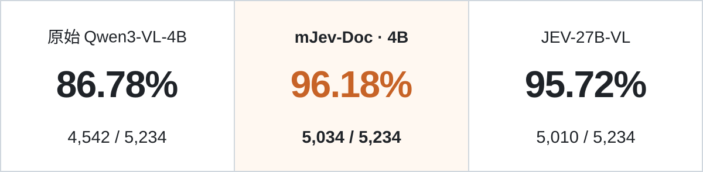

<p align="center">
  
</p>

<h1 align="center">SoMark｜mJev</h1>
<p align="center"><b>Multimodal state in. Typed decisions out.</b></p>

<p align="center"><b>简体中文</b> &nbsp;&nbsp; <a href="README.md">English</a></p>
<p align="center">
  <a href="https://huggingface.co/SoMarkAI/mjev-doc"></a>
  <a href="#start"></a>
  <a href="https://huggingface.co/datasets/Immortal-Zhang/DocJev-Bench"></a>
</p>

---

## 👀 超越文本的决策智能

**同一份视觉输入，可以回答多个决策问题。** 给 mJev 一张图片、一份文档或一段视频，定义问题和候选项，就能得到模型的选择、候选概率和原始 logits。

**mJev-Doc 专注文档。** 识别类别、核对字段、检查材料是否齐全，再按给定规则完成审核与分流。

- **⚡ 上下文接着用**：跨问题复用前缀 KV，支持批处理。
- **🧩 选项由你定**：每道题独立设置候选，数量不必相同。
- **🔎 决策看得见**：同时返回选择、候选概率和原始 logits。

---

> 如果这个项目对你有帮助，请点击右上角的 ⭐ Star——这是对开发者最大的鼓励！

<a id="models"></a>
<a id="mjev-doc"></a>

## 🧩 01 / 文档判断，先找 mJev-Doc

<table>
<tr>
<td width="50%" valign="top">
  <h3>📄 mJev-Doc</h3>
  <p><b>让文档理解走向业务判断。</b></p>
  <p>分类、字段关系、完整性检查，以及依据<strong>明确给定规则</strong>的审核与分流。</p>
  <a href="https://huggingface.co/SoMarkAI/mjev-doc"><b>获取模型 ↗</b></a>
</td>
<td width="50%" valign="top">
  <h3>🖼️ mJev</h3>
  <p><b>让图像与视频变成选择。</b></p>
  <p>场景、目标、动作、顺序……围绕共享视觉上下文连续提问，并为每题设置不同候选。</p>
  <a href="https://huggingface.co/SoMarkAI/mJev-Qwen3-VL-4B-RLCD"><b>获取模型 ↗</b></a>
</td>
</tr>
</table>

两个模型均基于 **Qwen3-VL-4B-Instruct**。支持 Hugging Face 与 vLLM 推理；音频和带音轨视频可使用独立的 [Qwen3-Omni 后端](docs/hf.zh-CN.md)。

## 🎯 02 / 文档决策，放到同一张答卷上

**[DocJev-Bench](https://huggingface.co/datasets/Immortal-Zhang/DocJev-Bench)** · 608 张图片 · 2,617 对中英文题目 · **5,234 条语言记录**

<p align="center">
  
</p>

覆盖 **文档理解与决策 · 跨行业分类**，按全部 5,234 条记录统一统计。

<sub>模型结果筛选集</sub>

[查看评测结果 →](docs/docjev/results.zh-CN.md)

<details>
<summary><b>⚡ 其他评测与缓存性能</b></summary>

- **mJev 通用视觉**：195 道题，77.95% → 80.00%。[评测记录](docs/training.zh-CN.md)
- **共享前缀缓存**：16 个问题，32.62 秒 → 6.29 秒（5.19×）。仅对应官方 Qwen3-VL-4B 的所述 24 GB 单卡配置。[测试记录](docs/cache_scaling.zh-CN.md)

</details>

<a id="start"></a>
<a id="quick-start"></a>

## 🚀 03 / 跑起来，轮到你的文档了

> 模型更新上传中：本页新成绩对应最佳 SFT 权重，当前 Hugging Face 下载仍为旧版。

Linux · Python 3.11+ · NVIDIA GPU。直接使用 Hugging Face，无需安装 vLLM。

```bash
git clone --branch docs/streamline-project-20261001 https://github.com/SoMarkAI/mJev.git
cd mJev
python3 -m venv .venv
source .venv/bin/activate
python -m pip install -e '.[docjev]' huggingface_hub
hf auth login
hf download SoMarkAI/mjev-doc --local-dir ./models/mjev-doc
CUDA_VISIBLE_DEVICES=0 python demo_docjev.py --model ./models/mjev-doc \
  --input examples/docjev/multiple.json --device-map cuda:0 \
  --output outputs/document-decisions.json
```

🎉 结果保存在 `outputs/document-decisions.json`。替换输入文件，就能测试自己的文档。

[文档输入输出](docs/docjev/input-output.md) &nbsp;&nbsp; [mJev-Doc 指南](docs/docjev/README.zh-CN.md) &nbsp;&nbsp; [多图片服务](docs/docjev/serving.zh-CN.md)

<details>
<summary><b>也想测试通用图片与视频？展开运行 mJev</b></summary>

视频需 FFmpeg。

```bash
python -m pip install torchcodec==0.11.0+cpu --index-url https://download.pytorch.org/whl/cpu
python -m pip install -e '.[hf-vl]' huggingface_hub
hf download SoMarkAI/mJev-Qwen3-VL-4B-RLCD --local-dir ./models/mJev
CUDA_VISIBLE_DEVICES=0 python demo_hf.py --model ./models/mJev \
  --input examples/multiple.json --mode causal --numerics stable --projection full \
  --prefix-cache --question-batch-size 2 --output outputs/image-decisions.json
```

[输入输出示例](examples/README.zh-CN.md) &nbsp;&nbsp; [Hugging Face 指南](docs/hf.zh-CN.md) &nbsp;&nbsp; [vLLM 服务](docs/vllm.zh-CN.md)

</details>

---

欢迎通过 [Issues](https://github.com/SoMarkAI/mJev/issues) 反馈问题、分享用法，也欢迎提交改进 ✨

<p><b>Build decisions, not just descriptions.</b></p>
<p>
  <a href="docs/index.zh-CN.md">完整文档</a> &nbsp;&nbsp;
  <a href="docs/docjev/architecture.md">工作原理</a> &nbsp;&nbsp;
  <a href="docs/docjev/training.md">训练方式</a> &nbsp;&nbsp;
  <a href="CONTRIBUTING.zh-CN.md">参与贡献</a>
</p>
<p>Apache-2.0（代码） &nbsp;&nbsp; <a href="NOTICE">NOTICE</a> &nbsp;&nbsp; <a href="THIRD_PARTY_LICENSES.zh-CN.md">第三方与模型许可证</a><br>感谢 <a href="https://github.com/Immortal-Zhang">Immortal-Zhang</a>、<a href="https://github.com/Kyousuke661">Kyousuke661</a> 与 <a href="https://github.com/BinyangQiu">BinyangQiu</a>。</p>
